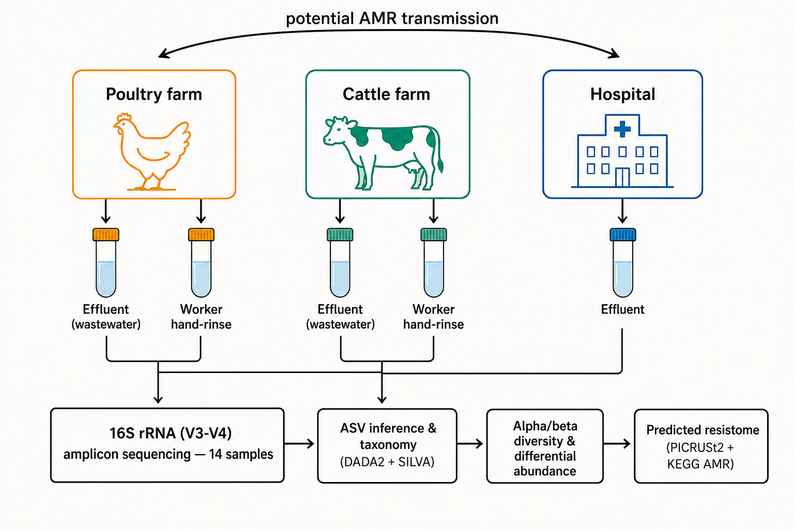

# amr_poultry

Cross-compartmental sharing of antimicrobial-resistant bacterial communities across poultry farm, cattle farm, and hospital environments in Bangladesh: a One Health 16S rRNA amplicon study.

## Overview

- **Sites:** poultry farm, cattle farm, hospital
- **Samples (n = 14):** farm effluent and worker hand-rinse; hospital effluent
- **Sequencing:** 16S rRNA V3–V4 amplicon
- **Analysis:** DADA2 + SILVA (ASVs, taxonomy) → alpha/beta diversity and differential abundance → predicted resistome (PICRUSt2 + KEGG AMR) → source tracking

## Repository

- `figures/` — manuscript figures (PNG/SVG)

## License

MIT — see [LICENSE](LICENSE).
